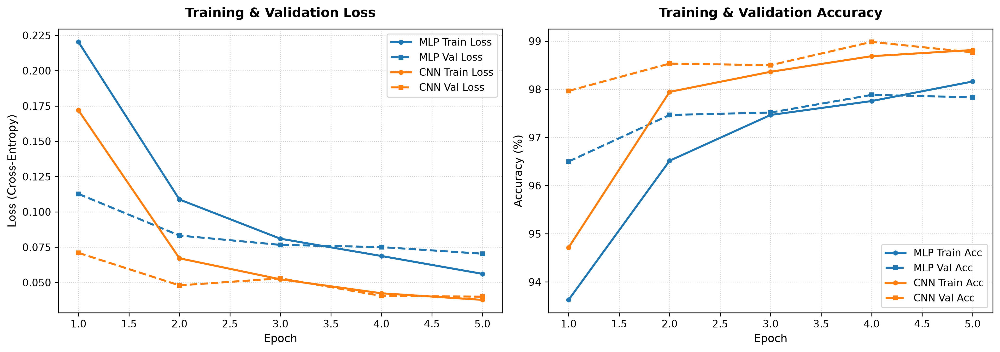
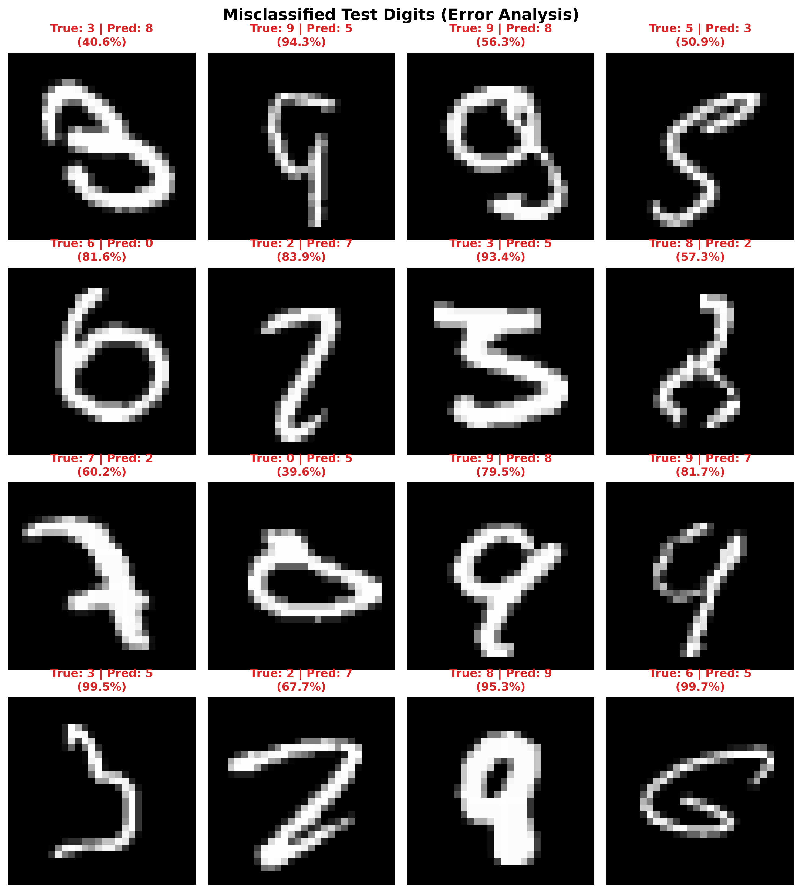

# MNIST Digit Classifier & Evaluation Pipeline

An end-to-end, modular, and reproducible machine learning pipeline for handwritten digit classification on the MNIST dataset using **PyTorch**. This repository includes a high-performing baseline **Multilayer Perceptron (MLP)** and a **Lightweight Convolutional Neural Network (CNN)**, complete with training curve tracking, held-out test evaluation, automated comparison benchmarking, and visual error analysis.

---

## 📁 Repository Structure

```text
mnist-classifier/
├── data/                       # Cached MNIST dataset (downloaded via torchvision)
├── checkpoints/                # Best model checkpoints (*.pt) and metric records
│   ├── mlp_best.pt             # Saved MLP model state dict
│   ├── cnn_best.pt             # Saved CNN model state dict
│   ├── history.json            # Per-epoch training & validation histories
│   └── evaluation_summary.json # Test benchmark metrics
├── models/
│   ├── __init__.py             # Model registry & factory function (`get_model`)
│   ├── mlp.py                  # Baseline Fully-Connected / Dense Architecture
│   └── cnn.py                  # Lightweight Convolutional Neural Network
├── utils/
│   ├── __init__.py
│   ├── dataset.py              # Data transforms, train/val/test splitting, seed setup
│   └── plots.py                # Loss/Accuracy curves & misclassification grid rendering
├── train.py                    # Modular training and validation runner
├── evaluate.py                 # Test set evaluation, comparison table, error analysis
├── requirements.txt            # Python dependencies
├── training_curves.png         # Generated training/validation loss & accuracy curves
├── misclassified_samples.png   # 4x4 visual error analysis grid of test misclassifications
└── README.md                   # Project documentation & benchmark analysis
```

---

## 🛠️ Installation & Setup

1. **Clone or navigate to the repository:**
   ```bash
   cd mnist-classifier
   ```

2. **Install required dependencies:**
   ```bash
   pip install -r requirements.txt
   ```

---

## 🚀 Usage

### 1. Training Both Models (MLP Baseline + CNN)
Run the unified training runner to train both architectures for 5 epochs:
```bash
python train.py --model all --epochs 5 --batch_size 64 --lr 0.001
```

Options:
- `--model`: `mlp`, `cnn`, or `all` (default: `all`)
- `--epochs`: Number of training epochs (default: `5`)
- `--batch_size`: Batch size for DataLoader (default: `64`)
- `--lr`: Learning rate for Adam optimizer (default: `0.001`)
- `--device`: `auto`, `cuda`, or `cpu` (default: `auto`)
- `--seed`: Random seed for reproducibility (default: `42`)

*Outputs:*
- Best model checkpoints saved to `checkpoints/mlp_best.pt` and `checkpoints/cnn_best.pt`.
- Metric history saved to `checkpoints/history.json`.
- Loss and Accuracy curves plotted and saved to `training_curves.png`.

### 2. Model Evaluation & Error Analysis
Evaluate the trained models on the held-out test set (10,000 samples):
```bash
python evaluate.py --batch_size 64
```

*Outputs:*
- Side-by-side comparative table summarizing Test Accuracy, Test Loss, Parameter Count, Inference Latency, and Throughput.
- Grid visualization of misclassified digits saved to `misclassified_samples.png`.
- Detailed evaluation summary written to `checkpoints/evaluation_summary.json`.

---

## 📐 Architecture Breakdown

### 1. Baseline Multilayer Perceptron (MLP)
- **Input**: Flattened $28 \times 28$ grayscale image ($784$ features).
- **Layer 1**: `Linear(784, 512)` $\rightarrow$ `BatchNorm1d(512)` $\rightarrow$ `ReLU` $\rightarrow$ `Dropout(p=0.2)`.
- **Layer 2**: `Linear(512, 256)` $\rightarrow$ `BatchNorm1d(256)` $\rightarrow$ `ReLU` $\rightarrow$ `Dropout(p=0.2)`.
- **Output Layer**: `Linear(256, 10)` producing 10 unnormalized class logits.
- **Total Parameters**: 537,354 parameters.
- **Optimization**: Cross-Entropy Loss (`nn.CrossEntropyLoss`) with Adam optimizer (`lr=1e-3`).

### 2. Lightweight Convolutional Neural Network (CNN)
- **Input**: Tensor shape $(B, 1, 28, 28)$.
- **Conv Block 1**:
  - `Conv2d(1, 16, kernel_size=3, padding=1)`
  - `BatchNorm2d(16)` $\rightarrow$ `ReLU` $\rightarrow$ `MaxPool2d(2, 2)` (feature map: $16 \times 14 \times 14$).
- **Conv Block 2**:
  - `Conv2d(16, 32, kernel_size=3, padding=1)`
  - `BatchNorm2d(32)` $\rightarrow$ `ReLU` $\rightarrow$ `MaxPool2d(2, 2)` (feature map: $32 \times 7 \times 7$).
- **Classifier**:
  - `Flatten` $\rightarrow$ `Linear(32 * 7 * 7 = 1568, 128)` $\rightarrow$ `ReLU` $\rightarrow$ `Dropout(p=0.3)` $\rightarrow$ `Linear(128, 10)`.
- **Total Parameters**: 206,970 parameters (**61.5% fewer parameters than MLP**).

---

## 🔬 Data Pipeline & Reproducibility
- **Normalization**: Standardized using MNIST global dataset statistics (mean: `0.1307`, standard deviation: `0.3081`).
- **Data Splits**:
  - **Training Set**: 54,000 images (90% of train set).
  - **Validation Set**: 6,000 images (10% of train set, fixed random generator seed).
  - **Test Set**: 10,000 held-out images.
- **Determinism**: `set_seed()` sets seeds across Python `random`, `numpy`, PyTorch CPU, and CUDA generators with deterministic cuDNN flags.

---

## 📊 Empirical Performance Comparison

Evaluated on the 10,000 held-out test images:

| Metric | Baseline MLP | Lightweight CNN | Winner / Advantage |
| :--- | :--- | :--- | :--- |
| **Architecture Type** | Fully-Connected (MLP) | Convolutional (CNN) | - |
| **Total Parameters** | 537,354 | **206,970** | **CNN** (61.5% fewer parameters) |
| **Validation Accuracy (Best)** | 97.88% | **98.98%** | **CNN** (+1.10%) |
| **Test Accuracy** | 97.86% | **99.02%** | **CNN** (+1.16%) |
| **Test Loss** | 0.0637 | **0.0295** | **CNN** (53.7% lower loss) |
| **Misclassified Samples** | 214 / 10,000 | **98 / 10,000** | **CNN (54.2% error reduction)** |
| **Avg Batch Latency (ms)** | **0.79 ms** | 3.65 ms | **MLP** (~4.6x faster on CPU) |
| **Throughput (imgs/sec)** | **81,515** | 17,533 | **MLP** (higher linear throughput) |
| **Training Time (5 epochs)**| **61.00s** | 84.91s | **MLP** |

---

## 📈 Visual Training Curves

The loss and accuracy progression across 5 epochs demonstrates stable convergence without severe overfitting, aided by Batch Normalization and Dropout:



---

## 🔍 Error Analysis & Insights

Below is the $4 \times 4$ grid of misclassified test digits produced by the CNN (`misclassified_samples.png`):



### Key Observations & Failure Modes:
1. **Severe Human Handwriting Ambiguity**:
   - `True: 3 | Pred: 8`: The top and bottom loops of handwritten 3s frequently pinch together, closely resembling an 8.
   - `True: 2 | Pred: 7`: A cursive top loop with an acute diagonal stroke lacks the bottom horizontal bar, mimicking a 7.
   - `True: 9 | Pred: 5`: Incomplete upper loops or non-standard stroke orders create patterns resembling a 5.
   - `True: 6 | Pred: 0`: The upper tail of the 6 curves tightly into the bottom bowl, causing the classifier to predict an elongated 0.
2. **Why CNN Outperforms MLP**:
   - The MLP flattens the $28 \times 28$ matrix into a $784$-dimensional 1D vector, completely discarding spatial 2D neighborhood relationships.
   - The CNN leverages **translation invariance** and local receptive fields via 2D convolutions, detecting edges, curves, and loops regardless of slight translations or stroke variations.
   - Despite having **61.5% fewer parameters**, the CNN cuts classification errors by **more than half (54.2% error reduction)**.
